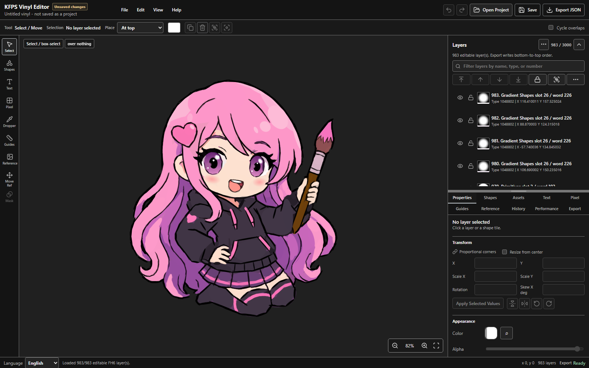
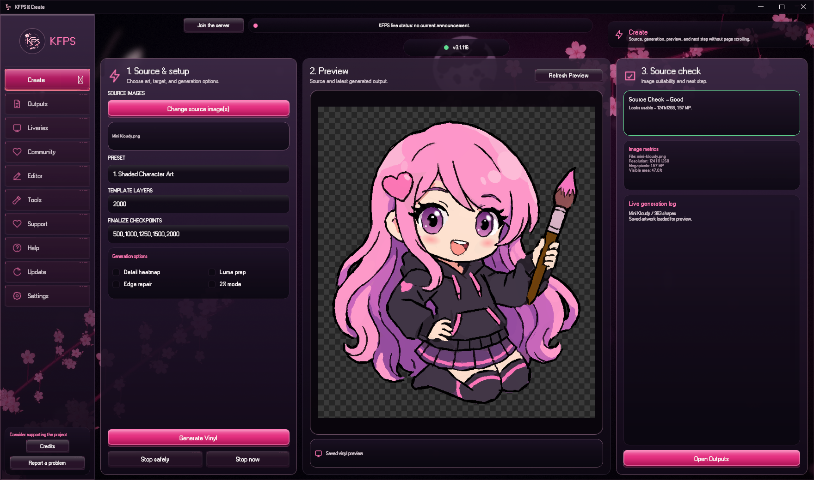
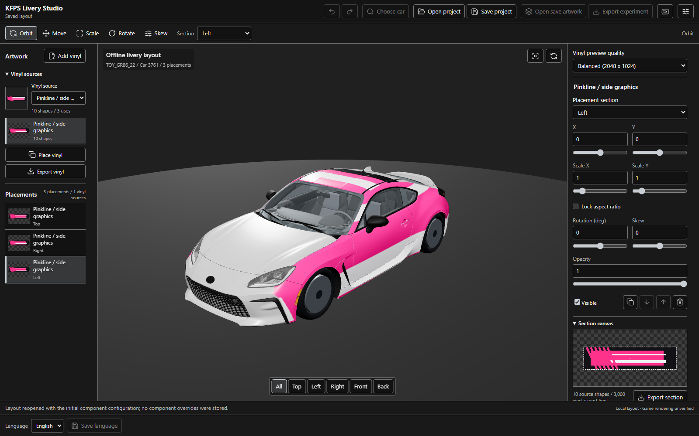
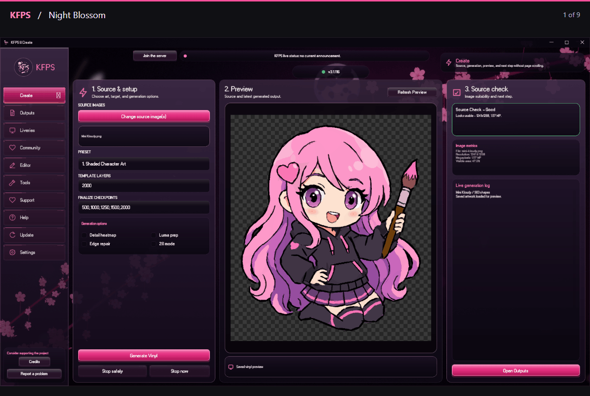
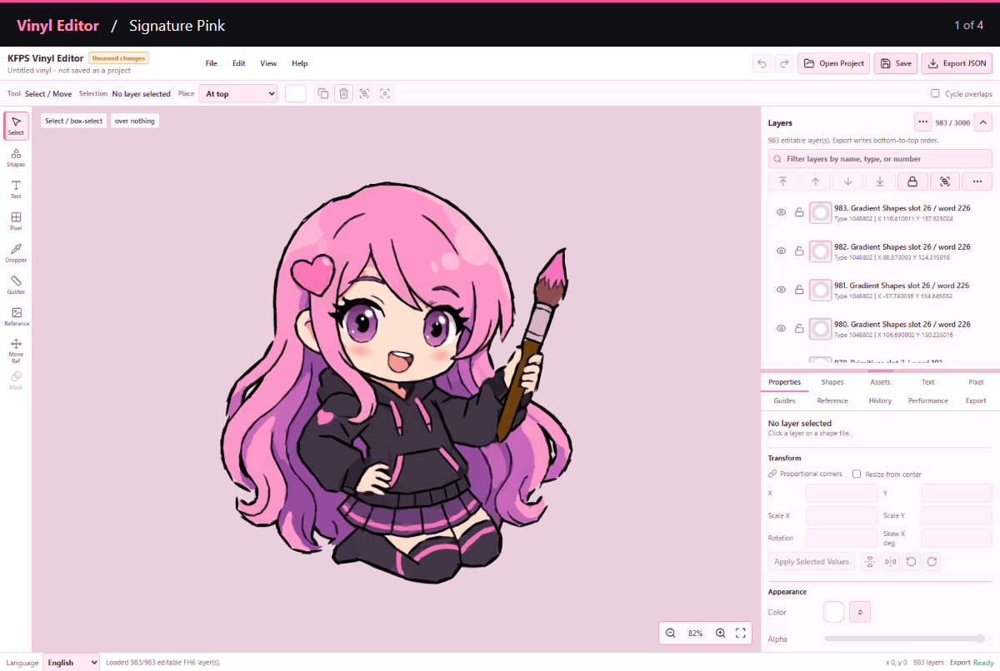
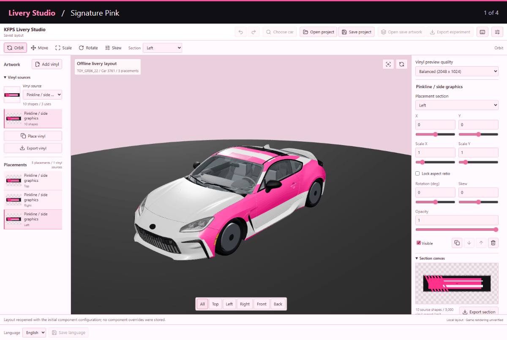

  

  
  
  

<b>Windows</b> &nbsp; / &nbsp; <b>Free creative tools</b> &nbsp; / &nbsp; <b>Native or Chrome editors</b>

Turn images into Forza vinyls, draw your own artwork, build a livery, and share what you make. **KFPS brings generation, the Vinyl Editor, Livery Studio, game transfers, and Community into one suite.**

The tools are free, including bulk import and export. Ko-fi support is optional. Existing supporter keys still unlock their exclusive themes.

<a href="#get-started">Get started</a> &nbsp; / &nbsp; <a href="#create">Create</a> &nbsp; / &nbsp; <a href="#vinyl-editor">Vinyl Editor</a> &nbsp; / &nbsp; <a href="#livery-studio">Livery Studio</a> &nbsp; / &nbsp; <a href="#game-transfers">Game transfers</a> &nbsp; / &nbsp; <a href="#community">Community</a> &nbsp; / &nbsp; <a href="#make-it-yours">Themes</a>

## Get Started

1. **[Download the bundled ZIP](https://github.com/heyitshestia/kloudys-forza-painter-suite/releases/latest)** and extract it into a writable folder. Choose the bundled app, not GitHub's Source code ZIP.
2. **Run `KFPS.exe`, then check Update.** The updater carries the newest patches between bundled releases.
3. **Pick your starting point.** Generate a vinyl in Create, open a JSON in the Vinyl Editor, or start a car layout in Studio.

Windows is required. Image generation needs a working OpenCL-capable GPU driver. The editors also offer an optional **Google Chrome** mode; Chrome is installed separately.

## Create

**Start with an image. Finish with editable Forza shapes.**

- GPU-assisted generation with presets for shaded artwork, flat colours, and gradients.
- Source checks, a live preview, progress, and a generation log.
- Multiple shape-count checkpoints from one run.
- Image queues and optional 2x search for a more thorough pass.
- Local background removal and upscaling to prepare your source.

Finished artwork goes into **Outputs**, alongside editor exports, game exports, and your library. Preview and organise files there, or right-click a JSON to **Open in Editor**.

## Vinyl Editor

**A proper workspace for the details.** Open it from KFPS or launch `KFPS Editor.exe` on its own.

| Work on | Tools you get |
| :--- | :--- |
| Shapes | Native shape library, search, favourites, text, and pixel-art tools. |
| Layers | Nested groups, multi-selection, drag reordering, visibility, locks, and overlap selection. |
| Transforms | Move, resize, rotate, skew, align, distribute, snap, and enter exact values. |
| Colour | Palettes, saved swatches, an eyedropper, recolouring, and opacity controls. |
| References | Guide images, visibility and opacity controls, size locking, and guides. |
| Workspace | Dock, detach, drag, resize, and reattach panels inside the editor. Save your layout or reset it. |
| Shortcuts | Customisable bindings, tooltips, and a searchable shortcut reference. |
| Reuse | Save selections as assets and bring them into other projects. |
| History | Undo/redo, named projects, Save As, and recent recovery checkpoints. |
| Export | Export checks and JSON that preserves nested groups for supported offline transfers. |

Double-click a shape in the layer list to centre and highlight it on the canvas. Canvas-to-layer navigation makes the trip back just as easy.

The native window and Chrome use the same editing workspace. **English, Korean, and Japanese** are available. Projects, custom themes, shortcuts, palettes, and favourites carry over.

## Livery Studio

**Put the vinyl on the car.** Experimental

Open Studio from **Liveries**, from the Vinyl Editor, or with the standalone `KFPSLiverySudio.exe` launcher.

- Browse cars from your local FH6 installation and configure available body parts.
- Add generated or native vinyls, then move, scale, rotate, and skew them **on the car**.
- Grab the whole vinyl, including the spaces between its shapes.
- Group, lock, hide, reorder, duplicate, align, and distribute placements.
- Mirror opposite-side artwork, with a separate option for readable lettering.
- Use native masks across overlapping vinyls.
- Recolour a selection or the whole layout. Send a source vinyl to the 2D editor and bring the edits back.
- Switch between **Fast, Balanced, and Sharp** preview quality without changing your artwork or exports.
- Save named projects, variants, and checkpoints in per-car folders, with undo/redo and recovery.
- Export individual vinyls and grouped sections. Full-car native export Experimental.

Studio has its own native/Chrome setting and supports English, Korean, and Japanese. Both editors can keep working with the main KFPS window closed.

### Saved Liveries

Browse saved FH6 designs with their game thumbnails, inspect them in the shared 3D viewer, and transfer eligible owned designs as `.kfpslivery` packages for the same car. Experimental

## Game Transfers

**Live** works with a game running on your PC. **Offline** reads or writes supported local save files. Neither term means publishing your design online.

| Game | Live vinyl import/export | Offline vinyl export | Offline vinyl import |
| :--- | :--- | :--- | :--- |
| **Forza Horizon 4** | Supported Microsoft Store/Xbox build | Yes | Microsoft Store/Xbox WGS; Steam Experimental |
| **Forza Horizon 5** | Yes | Yes | Microsoft Store/Xbox WGS and Steam Experimental |
| **Forza Horizon 6** | Yes | Yes | Yes |
| **Forza Motorsport (FM8)** | Yes | Yes | Yes Experimental |

**Keep your groups together.** Editor JSON exports and supported offline transfers preserve nested vinyl groups. Owned vinyls extracted from game saves can come back into the editor with their groups intact. Live-memory transfers remain flat.

Bulk transfers are free. Ownership checks, save validation, backups, and recovery safeguards still apply. Use your own artwork or work you have permission to use, and keep backups of your saves.

For live import, open the intended placeholder vinyl in-game and enter its actual template layer count. For live export, enter the actual artwork layer count. The in-app **Help** page covers the steps for each game and transfer route.

## Community

**Make something worth showing off.**

- Browse without an account, with visible **Handmade** and **Toolmade** labels.
- Search by title, tag, or creator; filter by game and category.
- Connect GitHub to publish, download, favourite artwork, and follow creators.
- Share revisions, browse creator profiles, and explore featured and timed releases.

**Verified access:** connect GitHub to Community for **14 days** and publish **10 distinct Handmade vinyls of your own**. Both requirements apply; Toolmade uploads do not count. Existing qualifying key holders receive permanent Verified access after their key is recognised once. Donations do not buy Verified access.

**[Join the KFPS Discord](https://discord.gg/hRu8AtzD9j)** for artwork, updates, feedback, and help.

## Make It Yours

The main app includes **five public themes**: Night Blossom, Command Prompt, Apex Vector, Night City 2077, and RX-93 Psycho-Frame.

Existing supporter keys also unlock **Windows 94, Patron's Atelier, Carbon Dark, and Overdrive 200X**.

### KFPS Themes

The editors have their own themes and custom colour controls, with no key required. Make a workspace that fits you, save it, and bring it back next time.

### Vinyl Editor Themes

### Livery Studio Themes

Theme previews cycle slowly. For still images: [KFPS](docs/screenshots/repo-page/create.png), [Vinyl Editor](docs/screenshots/repo-page/vinyl-editor.png), [Livery Studio](docs/screenshots/repo-page/livery-studio.png).

## Support My Work

I'm keeping KFPS's creative tools free. If you enjoy using them, **[supporting me on Ko-fi](https://ko-fi.com/O7O020EQNQ)** genuinely helps me keep improving the suite, fixing the rough edges, and building what comes next. It is optional, and very much appreciated.

Existing keys remain valid for supporter themes. New donations do not issue keys or unlock Verified status.

Now go make something worth showing off. **Crash out.**

## Help And Updates

- **How do I...?** Start with the searchable Help page inside KFPS.
- **Something broke?** Use **Report a Problem**. Review what is included before sending it. Never post keys, credentials, or private saves publicly.
- **What's new?** Read the [changelog](https://github.com/heyitshestia/kloudys-forza-painter-suite/blob/main/CHANGELOG.md).
- **Updating?** Save your work and close KFPS, both editors, and active jobs before running the standalone updater. Keep the application folder together.
- **Need a hand?** Visit [Support Discord](https://discord.gg/XT8dG8bDKy) or the [issue tracker](https://github.com/heyitshestia/kloudys-forza-painter-suite/issues).

KFPS is an unofficial Forza tool and is not affiliated with Microsoft, Xbox, or the Forza studios. Keep backups and use it responsibly.

## Credits

Built on the work of [Forza Painter](https://github.com/forza-painter/forza-painter), [BVZRays](https://github.com/bvzrays/forza-painter-fh6), [GPU Geometrize](https://github.com/zjl88858/forza-painter-geometrize-gpu), [Sam Twidale](https://samcodes.co.uk/), [Michael Fogleman's primitive](https://github.com/fogleman/primitive), and [Fabric.js](https://fabricjs.com/).

Thanks to [Arstz / ForzaLiveryStudio](https://github.com/Arstz/ForzaLiveryStudio), [D3FEKT / ForzaTechStudio](https://github.com/D3FEKT/ForzaTechStudio), their contributors, and everyone helping with translations, testing, artwork, and feedback. Full acknowledgements are in the app's Credits.

[KFPS / Forza Painter license](https://github.com/heyitshestia/kloudys-forza-painter-suite/blob/main/LICENSE) · [GPU generator license](https://github.com/heyitshestia/kloudys-forza-painter-suite/blob/main/LICENSE.geometrize-gpu) · [Importer license](https://github.com/heyitshestia/kloudys-forza-painter-suite/blob/main/LICENSE.custom-importer) · [Fabric.js license](https://github.com/heyitshestia/kloudys-forza-painter-suite/blob/main/LICENSE.fabricjs)

Product captures use a staged local workspace on 3.1.116. Mini Kloudy is shown with permission; Studio artwork was created for this page. Code licences do not grant rights to the pictured artwork or game assets.
